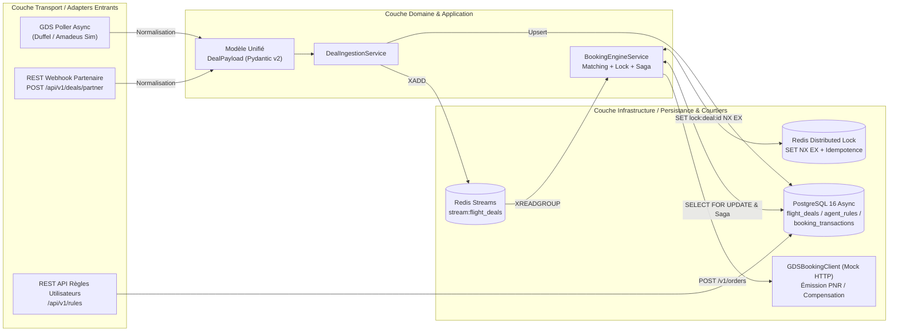

# Flight Smart Booking POC (`LastSeat`)

Plateforme événementielle (**Event-Driven**) haute concurrence en **Python 3.11 / FastAPI / Redis Streams / PostgreSQL Async (SQLAlchemy 2.0)** pour l'ingestion multi-sources de billets d'avion de dernière minute et l'achat autonome par agents logiciels.

---

## 1. Architecture & Principes Directeurs (Clean Architecture / Ports & Adapters)



### Garanties Architecturales
1. **Séparation stricte des responsabilités** :
   - **Couche Transport (`app/api/`, `BookingEngineStreamWorker`)** : Validation HTTP (`X-Partner-API-Key`), sérialisation et consommation asynchrone des événements Redis Streams (`XREADGROUP` / `XACK`).
   - **Couche Métier / Domaine (`app/schemas.py`, `app/services/booking_engine.py`)** : Modèle canonique `DealPayload`, algorithme de matching multi-critères (incluant wildcard de destination), coordination des verrous distribués et machine à états **Saga**.
   - **Couche Persistance & Adapters Sortants (`app/models.py`, `app/database.py`, `app/services/gds_client.py`)** : SQLAlchemy 2.0 `AsyncSession` (`asyncpg`), `redis.asyncio`, et client HTTP asynchrone `httpx`.
2. **Ingestion Multi-Sources Unifiée (`DealPayload`)** :
   - **Source 1 (`GDSPollerService`)** : Tâche de fond asynchrone simulant le polling de flux GDS (Duffel / Amadeus Sandbox).
   - **Source 2 (`POST /api/v1/deals/partner`)** : Endpoint REST sécurisé par clé d'API (`X-Partner-API-Key`) permettant aux voyagistes/charters d'injecter leurs contingents d'invendus (`PartnerDealIngestionRequest.to_deal_payload()`).
3. **Haute Concurrence, Verrouillage Distribué & Idempotence** :
   - **Idempotence stricte (`deal_id + user_id`)** : Vérifiée en amont via Redis (`SET idempotency:booking:{deal_id}:{user_id} PROCESSING NX EX 86400`) et garantie en base par la contrainte `UNIQUE (deal_id, user_id)`.
   - **Verrou distribué Redis (`SET lock:deal:{deal_id} <token> NX EX 15`)** : Empêche toute collision lors de l'évaluation concurrente d'un même deal par plusieurs agents. La libération du verrou est exécutée atomiquement via un script Lua comparant le jeton propriétaire.
   - **Verrouillage pessimiste SQL (`SELECT ... FOR UPDATE`)** : Garantit que `seats_available` ne tombe jamais en négatif.
4. **Pattern Saga & Transaction de Compensation** :
   - **Étape 1 (Réservation locale)** : Décrémentation de `seats_available` (passage à `SOLD_OUT` si `0`) et création d'une `BookingTransaction` à l'état `PENDING_GDS`.
   - **Étape 2 (Émission GDS)** : Appel HTTP asynchrone vers `GDSBookingClient.issue_ticket()`.
   - **Étape 3a (Succès)** : Transition vers `CONFIRMED` avec enregistrement du `pnr_reference`.
   - **Étape 3b (Échec -> Compensation)** : En cas d'erreur ou timeout GDS, exécution immédiate de la **transaction de compensation** : ré-incrémentation de `seats_available += 1`, restauration du statut `ACTIVE` sur le deal, passage de la transaction à `COMPENSATED_FAILED` avec le motif d'erreur, et libération immédiate du verrou Redis.

---

## 2. Structure du Répertoire

```text
flight-smart-booking-poc/
├── docker-compose.yml
├── Dockerfile
├── pyproject.toml
├── requirements.txt
├── .env.example
├── README.md
├── sql/
│   └── init.sql
└── app/
    ├── __init__.py
    ├── config.py
    ├── database.py
    ├── schemas.py
    ├── models.py
    ├── api/
    │   ├── __init__.py
    │   ├── deals.py           # Endpoints partenaires et consultation
    │   └── rules.py           # Configuration des règles de l'agent par l'utilisateur
    ├── services/
    │   ├── __init__.py
    │   ├── booking_engine.py  # Moteur de matching, locking distribué et Saga
    │   ├── gds_client.py      # Client HTTP mocké vers l'API de réservation GDS
    │   └── ingestion.py       # Service d'ingestion unifié & Poller asynchrone GDS
    └── main.py
```

---

## 3. Démarrage Rapide

### Option A : Avec Docker Compose (Recommandé — Clé en main)

```bash
docker compose up --build -d
docker compose logs -f api
```

- **API FastAPI & Swagger UI** : [http://localhost:8000/docs](http://localhost:8000/docs)
- **Healthcheck** : [http://localhost:8000/health](http://localhost:8000/health)

### Option B : Développement local avec `uv`

```bash
# 1. Démarrer uniquement PostgreSQL et Redis via Docker
docker compose up -d postgres redis

# 2. Synchroniser l'environnement virtuel avec uv
uv sync

# 3. Lancer l'application FastAPI avec Uvicorn via uv
uv run uvicorn app.main:app --reload --host 0.0.0.0 --port 8000
```

---

## 4. Scénarios de Validation de Bout en Bout (`curl`)

### Étape 1 : Vérifier l'état de santé et les règles pré-initialisées (`init.sql`)
Au démarrage, 3 règles d'agents autonomes sont pré-chargées :
- `usr_alice_01` : **CDG -> JFK**, budget max **290.00 EUR**
- `usr_bob_02` : **CDG -> JFK**, budget max **320.00 EUR**
- `usr_claire_nomad` : **ORY -> \* (Wildcard toute destination)**, budget max **150.00 EUR**

```bash
curl -s http://localhost:8000/health | jq
curl -s http://localhost:8000/api/v1/rules | jq
```

### Étape 2 : Créer une nouvelle règle d'achat autonome

```bash
curl -s -X POST http://localhost:8000/api/v1/rules \
  -H "Content-Type: application/json" \
  -d '{
    "user_id": "usr_david_04",
    "origin": "CDG",
    "destination": "JFK",
    "max_price": 275.00,
    "currency": "EUR",
    "preferred_cabin": "ECONOMY",
    "auto_purchase_enabled": true,
    "passenger_info": {
      "first_name": "David",
      "last_name": "Moreau",
      "email": "david@example.com",
      "passport": "FR44556677"
    }
  }' | jq
```

### Étape 3 : Tester la Haute Concurrence & Anti-Double-Booking (1 seul siège disponible pour 3 acheteurs éligibles)
Injectons via le webhook partenaire un vol **CDG -> JFK à 240.00 EUR** avec **`remaining_seats: 1`** et succès GDS garanti (`force_gds_success: true`).
Les agents de `usr_bob_02`, `usr_alice_01` et `usr_david_04` matchent simultanément, mais grâce au verrou distribué Redis (`SET lock:deal:... NX EX`) et au `SELECT ... FOR UPDATE`, **un seul billet est émis** et le deal passe immédiatement à `SOLD_OUT` :

```bash
curl -s -X POST http://localhost:8000/api/v1/deals/partner \
  -H "Content-Type: application/json" \
  -H "X-Partner-API-Key: sk-partner-charter-secret-key-2026" \
  -d '{
    "partner_deal_ref": "CHARTER-AF-LASTSEAT-01",
    "carrier_iata": "AF",
    "flight_code": "AF008",
    "departure_airport": "CDG",
    "arrival_airport": "JFK",
    "takeoff_utc": "2026-10-20T10:00:00Z",
    "landing_utc": "2026-10-20T18:00:00Z",
    "unit_price": 240.00,
    "currency": "EUR",
    "cabin": "ECONOMY",
    "remaining_seats": 1,
    "offer_valid_until_utc": "2026-10-20T09:00:00Z",
    "partner_notes": {
      "force_gds_success": true
    }
  }' | jq
```

Vérifions le deal (`status: "SOLD_OUT"`, `seats_available: 0`) et la transaction confirmée avec son `pnr_reference` :

```bash
curl -s http://localhost:8000/api/v1/deals/PARTNER-CHARTER-AF-LASTSEAT-01 | jq
curl -s "http://localhost:8000/api/v1/rules/bookings/transactions?deal_id=PARTNER-CHARTER-AF-LASTSEAT-01" | jq
```

### Étape 4 : Tester le Pattern Saga & la Compensation Automatique sur Échec GDS
Injectons un deal avec un code vol se terminant par `FAIL` (ex: `TO999FAIL`). Le moteur réserve le siège, appelle le GDS qui échoue (HTTP 502), puis exécute immédiatement la **transaction de compensation** : le siège est remis en stock (`seats_available: 1`, `status: "ACTIVE"`), le verrou Redis est relâché et la transaction est tracée en `COMPENSATED_FAILED` :

```bash
curl -s -X POST http://localhost:8000/api/v1/deals/partner \
  -H "Content-Type: application/json" \
  -H "X-Partner-API-Key: sk-partner-charter-secret-key-2026" \
  -d '{
    "partner_deal_ref": "CHARTER-SAGA-FAIL-01",
    "carrier_iata": "TO",
    "flight_code": "TO999FAIL",
    "departure_airport": "ORY",
    "arrival_airport": "LIS",
    "takeoff_utc": "2026-10-20T14:00:00Z",
    "landing_utc": "2026-10-20T16:30:00Z",
    "unit_price": 95.00,
    "currency": "EUR",
    "cabin": "ECONOMY",
    "remaining_seats": 1,
    "offer_valid_until_utc": "2026-10-20T13:00:00Z",
    "partner_notes": {
      "force_gds_failure": true
    }
  }' | jq

# Observer la transaction compensée (status = COMPENSATED_FAILED) et le siège restauré (seats_available = 1)
curl -s "http://localhost:8000/api/v1/rules/bookings/transactions?deal_id=PARTNER-CHARTER-SAGA-FAIL-01" | jq
curl -s http://localhost:8000/api/v1/deals/PARTNER-CHARTER-SAGA-FAIL-01 | jq
```
